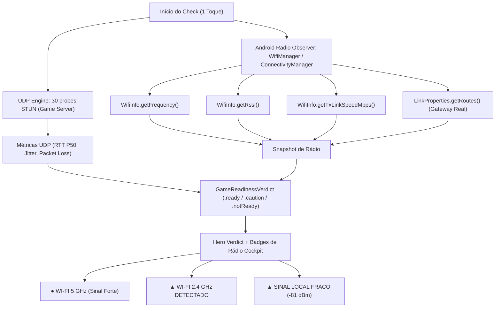

# Architecture Plan — LagCheck Android Expansion & Radio Telemetry

> Documento mantido por **Camillo** (Principal Engineer / System Architect) e **Marco** (Product Lead) conforme Decisão 67 e governança Buildea (`AGENTS.md` e `.agents/WORKFLOW.md`).

---

## 1. Contexto e Problema
- **Problema a resolver:** O LagCheck foi concebido inicialmente para iOS 17+. No entanto, o ecossistema Android expõe métricas cruciais de rádio e enlace físico que a Apple bloqueia na sandbox do iOS (frequência exata em MHz, RSSI em dBm, taxa PHY Tx/Rx e detecção física de perda de pacotes Wi-Fi). A expansão para Android deve viabilizar esse diferencial competitivo mantendo paridade determinística de regras de negócio, fidelidade ao Design System *Dark Competitive UI* e custo operacional recorrente zero.
- **Comportamento esperado:** Um projeto Android nativo modular (Kotlin + Jetpack Compose) capaz de executar o mesmo fluxo de medição determinística do iOS (`Home → Jogo → Check → Veredito`), aproveitando dados de rádio Android para enriquecer a telemetria sem adicionar texto confuso, cumprindo a "Regra do Discord" (Decisão 64) e a integridade diagnóstica (Decisão 50).
- **Frente solicitante / Autor do aceite:** Marco (Product Lead) / Autorização do Dono do Produto (Luiz).

---

## 2. Escopo Arquitetural
- **Módulos Afetados / Novos:**
  - [x] Repositório root: `.gitignore` atualizado para artefatos Android/Gradle.
  - [x] `android/`: Raiz do projeto Android multiplataforma.
    - `:core:domain` (Kotlin puro, JVM puro — sem Android SDK): Port direto de `NolaggyDomain` (regras de score, `GameReadinessVerdict`, thresholds, RFC 4737).
    - `:core:network` (Kotlin + Coroutines / Java NIO): Cliente STUN RFC 5389 UDP, cálculo de jitter RFC 4737, bufferbloat client `/v1/load`.
    - `:core:telemetry-radio` (Android SDK `WifiManager`, `ConnectivityManager`, `TelephonyManager`): Frequência 2.4/5/6 GHz, RSSI dBm, LinkSpeed, Gateway discovery.
    - `:core:designsystem` (Jetpack Compose): Implementação dos tokens canônicos LagCheck (Roxo Gamer `#7C3AED`, Coral Solar `#FF5A36` para atenção, cockpit mono, raios 8/13/17/26/999px).
    - `:app` (Jetpack Compose): Telas da jornada direta (`Home`, `Seletor de Jogo`, `Cockpit Check`, `Veredito`).
- **Módulos Inalterados (Preservação Total):**
  - [x] `Sources/` e `Tests/` (Código iOS / Swift intacto).
  - [x] `Nolaggy.xcodeproj` e `project.yml` (Build iOS intacto).
  - [x] `worker/` (Cloudflare Worker `nolaggy-deep-check` inalterado; serve ambos os clientes).
  - [x] `web/` (Website institucional inalterado).
- **Não-objetivos (Out of Scope):**
  - Frameworks híbridos (Flutter, React Native) — descartados por latência de socket e overhead de rádio.
  - SDKs de anúncios ou ferramentas pagas de telemetria/APM.

---

## 3. Decisão Técnica & Desenho da Solução

### 3.1. Estrutura Modular Gradle
```
android/
├── build.gradle.kts
├── settings.gradle.kts
├── gradle/
│   └── libs.versions.toml       # Version Catalog centralizado
├── core/
│   ├── domain/                  # Kotlin puro (sem dependência Android)
│   ├── network/                 # UDP Engine + STUN RFC 5389 + Worker client
│   ├── telemetry-radio/         # WifiManager + Radio stats (O diferencial Android)
│   └── designsystem/            # Jetpack Compose Dark Competitive UI tokens
└── app/                         # App target (Telas e Composição)
```

### 3.2. Fluxo da Telemetria de Rádio (O Diferencial Android)


---

## 4. Política de Permissões e Privacidade
1. **Zero Bloqueio:** O usuário NUNCA é impedido de medir o ping do jogo caso negue permissões de rede/localização.
2. **Permissões Granulares:**
   - `ACCESS_NETWORK_STATE`: Para saber se há conexão e tipo de transporte (Wi-Fi vs Celular). Não exige prompt ao usuário.
   - `NEARBY_WIFI_DEVICES` (Android 13+, com flag `neverForLocation`): Permite ler dados de rádio Wi-Fi sem rastrear GPS.
   - Se o usuário não conceder: o app funciona em modo clássico (idêntico ao iOS, focando na medição UDP dos servidores).

---

## 5. Resiliência e Concorrência
- **Kotlin Coroutines + Structured Concurrency:** O ciclo da medição opera em um `CoroutineScope` vinculado ao ciclo de vida da tela (`viewModelScope`).
- **Cancelamento Cooperativo:** Sair da tela cancela a Coroutine e fecha o socket `DatagramChannel` imediatamente sem vazamento de recursos.
- **Descarte de Amostras Inválidas:** Menos de 10 respostas UDP válidas resulta rigorosamente em `.inconclusive`. Proibido fallback para HTTP/ICMP.

---

## 6. Custos e Segurança
- **Custo Operacional Zero:** Reutilização estrita dos endpoints existentes no Cloudflare Worker:
  - `GET /v1/catalog.json` (Validação de assinatura Ed25519 no app Android).
  - `GET /v1/load` (Download de buffer estático para teste de saturação).
  - `POST /v1/telemetry` (Eventos anônimos sem PII/IP).
- **Sem SDKs Terceiros:** Zero Firebase, zero Google Analytics, zero SDKs de terceiros invasivos.

---

## 7. Status do Gate Arquitetural
- [x] Investigação concluída por Camillo e Iury
- [x] Plano aprovado por Camillo e alinhado com Marco
- [x] Infraestrutura do repositório preparada
- [ ] Implementação de `:core:domain` e `:core:network` em Kotlin
- [ ] Implementação de `:core:telemetry-radio`
- [ ] Implementação das telas em Jetpack Compose
- [ ] Homologação em dispositivos reais por Breno
