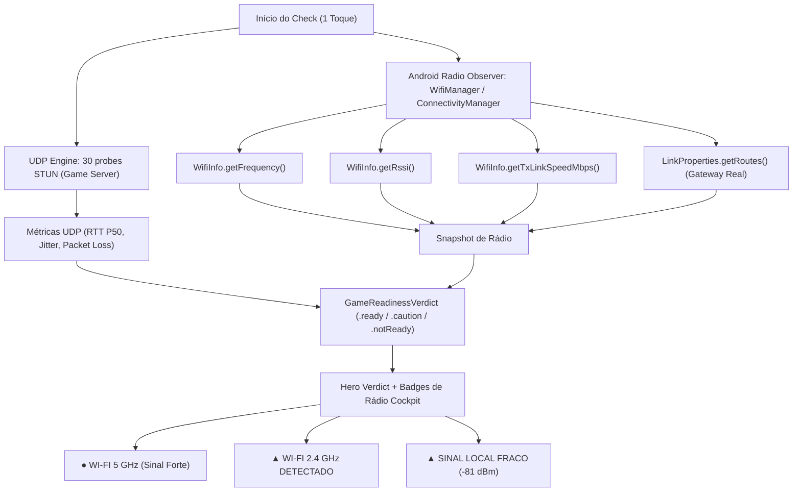

# Architecture Plan — LagCheck Android Expansion & Radio Telemetry

> Documento mantido por **Camillo** (Principal Engineer / System Architect) e **Marco** (Product Lead) conforme Decisão 67 e governança Buildea (`AGENTS.md` e `.agents/WORKFLOW.md`).

---

## 1. Contexto e Problema
- **Problema a resolver:** O LagCheck foi concebido inicialmente para iOS 17+. No entanto, o ecossistema Android expõe métricas cruciais de rádio e enlace físico que a Apple bloqueia na sandbox do iOS (frequência exata em MHz, RSSI em dBm, taxa PHY Tx/Rx e detecção física de perda de pacotes Wi-Fi). A expansão para Android deve viabilizar esse diferencial competitivo mantendo paridade determinística de regras de negócio, fidelidade ao Design System *Dark Competitive UI* e custo operacional recorrente zero.
- **Comportamento esperado:** Um projeto Android nativo modular (Kotlin + Jetpack Compose) capaz de executar o mesmo fluxo de medição determinística do iOS (`Home → Jogo → Check → Veredito`), aproveitando dados de rádio Android para enriquecer a telemetria sem adicionar texto confuso, cumprindo a "Regra do Discord" (Decisão 64) e a integridade diagnóstica (Decisão 50).
- **Frente solicitante / Autor do aceite:** Marco (Product Lead) / Autorização do Dono do Produto (Luiz).

---

## 2. Escopo Arquitetural
- **Módulos Afetados / Novos:**
  - [x] Repositório root: `.gitignore` atualizado para artefatos Android/Gradle.
  - [x] `android/`: Raiz do projeto Android multiplataforma.
    - `:core:domain` (Kotlin puro, JVM puro — sem Android SDK): Port direto de `NolaggyDomain` (regras de score, `GameReadinessVerdict`, thresholds, RFC 4737).
    - `:core:network` (Kotlin + Coroutines / Java NIO): Cliente STUN RFC 5389 UDP, cálculo de jitter RFC 4737, bufferbloat client `/v1/load`.
    - `:core:telemetry-radio` (Android SDK `WifiManager`, `ConnectivityManager`, `TelephonyManager`): Frequência 2.4/5/6 GHz, RSSI dBm, LinkSpeed, Gateway discovery.
    - `:core:designsystem` (Jetpack Compose): Implementação dos tokens canônicos LagCheck (Roxo Gamer `#7C3AED`, Coral Solar `#FF5A36` para atenção, cockpit mono, raios 8/13/17/26/999px).
    - `:app` (Jetpack Compose): Telas da jornada direta (`Home`, `Seletor de Jogo`, `Cockpit Check`, `Veredito`).
- **Módulos Inalterados (Preservação Total):**
  - [x] `Sources/` e `Tests/` (Código iOS / Swift intacto).
  - [x] `Nolaggy.xcodeproj` e `project.yml` (Build iOS intacto).
  - [x] `worker/` (Cloudflare Worker `nolaggy-deep-check` inalterado; serve ambos os clientes).
  - [x] `web/` (Website institucional inalterado).
- **Não-objetivos (Out of Scope):**
  - Frameworks híbridos (Flutter, React Native) — descartados por latência de socket e overhead de rádio.
  - SDKs de anúncios ou ferramentas pagas de telemetria/APM.

---

## 3. Decisão Técnica & Desenho da Solução

### 3.1. Estrutura Modular Gradle
```
android/
├── build.gradle.kts
├── settings.gradle.kts
├── gradle/
│   └── libs.versions.toml       # Version Catalog centralizado
├── core/
│   ├── domain/                  # Kotlin puro (sem dependência Android)
│   ├── network/                 # UDP Engine + STUN RFC 5389 + Worker client
│   ├── telemetry-radio/         # WifiManager + Radio stats (O diferencial Android)
│   └── designsystem/            # Jetpack Compose Dark Competitive UI tokens
└── app/                         # App target (Telas e Composição)
```

### 3.2. Fluxo da Telemetria de Rádio (O Diferencial Android)


---

## 4. Política de Permissões e Privacidade
1. **Zero Bloqueio:** O usuário NUNCA é impedido de medir o ping do jogo caso negue permissões de rede/localização.
2. **Permissões Granulares:**
   - `ACCESS_NETWORK_STATE`: Para saber se há conexão e tipo de transporte (Wi-Fi vs Celular). Não exige prompt ao usuário.
   - `NEARBY_WIFI_DEVICES` (Android 13+, com flag `neverForLocation`): Permite ler dados de rádio Wi-Fi sem rastrear GPS.
   - Se o usuário não conceder: o app funciona em modo clássico (idêntico ao iOS, focando na medição UDP dos servidores).

---

## 5. Resiliência e Concorrência
- **Kotlin Coroutines + Structured Concurrency:** O ciclo da medição opera em um `CoroutineScope` vinculado ao ciclo de vida da tela (`viewModelScope`).
- **Cancelamento Cooperativo:** Sair da tela cancela a Coroutine e fecha o socket `DatagramChannel` imediatamente sem vazamento de recursos.
- **Descarte de Amostras Inválidas:** Menos de 10 respostas UDP válidas resulta rigorosamente em `.inconclusive`. Proibido fallback para HTTP/ICMP.

---

## 6. Custos e Segurança
- **Custo Operacional Zero:** Reutilização estrita dos endpoints existentes no Cloudflare Worker:
  - `GET /v1/catalog.json` (Validação de assinatura Ed25519 no app Android).
  - `GET /v1/load` (Download de buffer estático para teste de saturação).
  - `POST /v1/telemetry` (Eventos anônimos sem PII/IP).
- **Sem SDKs Terceiros:** Zero Firebase, zero Google Analytics, zero SDKs de terceiros invasivos.

---

## 7. Plano de Port iOS → Android (Decisão 68)

> Gate Arquitetural cumprido por Camillo + Iury. Fonte de verdade das regras: o código Swift em `Sources/NolaggyDomain` (readiness-v2.0) e o catálogo v3 assinado em `worker/catalog/`. O Kotlin é port, não reinterpretação.

### 7.1 Diagnóstico do estado anterior (por que não era port)
| Gap | Estado no Android antes do port | Alvo |
| --- | --- | --- |
| Regras de veredito | Thresholds fixos (110 ms / 25 ms / 2%), sem perfil | `QualityEvaluator` (3 perfis) + `ResultInterpreter` + `GameReadinessEvaluator` readiness-v2.0 |
| Destino da medição | STUN `stun.l.google.com` fixo | Beacons do catálogo assinado: `gameLiftPing`, `playFabQoS`, `steamA2S` |
| Catálogo | 20 jogos hardcoded | Envelope v3 verificado com Ed25519 + validação + resolução de rota |
| Fase de carga | 1 fluxo de 30 probes cortado em 18/12 | Repouso (30 probes) e carga (30 probes) separados, `/v1/load` concorrente só na segunda |
| Telemetria Worker | Cliente existe, ninguém chama | `app_open`, `check_started`, `verdict_viewed`, `retest_started` |
| Release | `proguard-rules.pro` ausente, `targetSdk` 34, `ACCESS_FINE_LOCATION` sem teto | Corrigidos (fast lane) |

### 7.2 Módulos
```
android/core/domain    Kotlin puro. Perfis, QualityEvaluator, SampleQuality, SpikePattern,
                       DeepCheck (carga v2), ResultInterpreter, GameReadinessEvaluator v2.0.
android/core/catalog   Kotlin puro (kotlinx-serialization). Ed25519 (RFC 8032, verify-only, BigInteger),
                       envelope, validação do payload, resolução de rota por jogo/plataforma/mercado.
android/core/network   JVM. Codecs (GameLift/PlayFab/Steam), ProbeLedger, UdpProbeTransport,
                       WorkerClient (/v1/load, /v1/catalog.json, /v1/telemetry). STUN permanece só como codec legado.
android/core/telemetry-radio  Android SDK. Inalterado (diferencial de rádio).
android/core/designsystem     Compose. Inalterado.
android/app            Composição: ViewModel orquestra catálogo → rota → repouso → carga → veredito.
```
Regra de dependência: `domain` ← `catalog` ← `network` ← `app`. Nenhum módulo JVM importa Android SDK.

### 7.3 Decisões de desenho
1. **Plataforma "mobile".** O catálogo v3 assinado só conhece `iphone|playstation|xbox|pc|nintendo`. Não temos a chave privada para re-assinar com `android`. O resolvedor Android trata o contexto `iphone` como o contexto de celular. Impacto: nenhum, pois as rotas de celular são as mesmas `awsFallback sa-east-1`. Quando o catálogo ganhar `android`, o resolvedor prefere o contexto exato.
2. **Ed25519 sem dependência.** `Signature.getInstance("Ed25519")` só existe no Android 13+, e o `minSdk` é 26. Implementação verify-only em Kotlin puro, validada contra os vetores do RFC 8032 e contra o envelope real do Worker. Zero SDK novo.
3. **Base embarcada + atualização diária**, igual ao iOS (`RemoteCatalogRepository`): envelope v3 vai em `assets/`, cache em arquivo, uma tentativa de refresh por dia, falha mantém o catálogo válido.
4. **Sem rota ativa, sem medição.** Rota `gameOwned` com status `pending` não é medida. Só `awsFallback` ativa mede, com confiança `medium` (margem de 10% nos guardrails, igual ao iOS).
5. **Fora do port V1 Android (decisão consciente, não esquecimento):** Deep Check manual separado, NAT/STUN, qualidade de voz, Connection Booster (Gemini) e probe de gateway. O probe de gateway fica para a fase 2, e **até lá o Android não diz nada sobre roteador ou Wi-Fi como causa** (Decisão 50). A telemetria de rádio entra como fato observado (banda, RSSI), nunca como causa.

### 7.4 Critérios de aceite
- `./gradlew :core:domain:test :core:catalog:test :core:network:test` verde (validado neste ambiente com Gradle JVM).
- Vetores portados dos testes Swift (`QualityEvaluator*`, `SpikePattern`, `SampleQuality`, `ResultInterpreter`, `GameReadinessDomain`, `DeepCheckEvaluator`, `RemoteCatalog`, codecs) passando em Kotlin.
- Envelope `catalog-v3.envelope.json` real verifica; envelope adulterado, expirado ou com payload alterado é recusado.
- Transporte UDP exercitado em loopback (eco válido, timeout, resposta inválida, cancelamento sem vazar socket).
- Módulos Android (`app`, `telemetry-radio`, `designsystem`) **não** são compiláveis no ambiente de CI do agente (Google Maven bloqueado). Estado reportado: *implementado, não compilado*. Compilação e hardware físico ficam com Breno.

## 8. Status do Gate Arquitetural
- [x] Investigação concluída por Camillo e Iury
- [x] Plano aprovado por Camillo e alinhado com Marco
- [x] Infraestrutura do repositório preparada
- [x] Decisão 68 registrada
- [ ] `:core:domain` readiness-v2.0
- [ ] `:core:catalog`
- [ ] `:core:network` (beacons + Worker)
- [ ] Integração `:app`
- [ ] Compilação do app e homologação em dispositivo real por Breno
