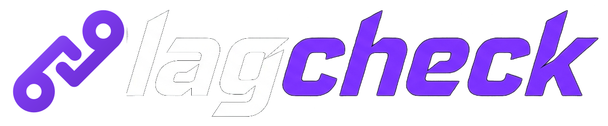
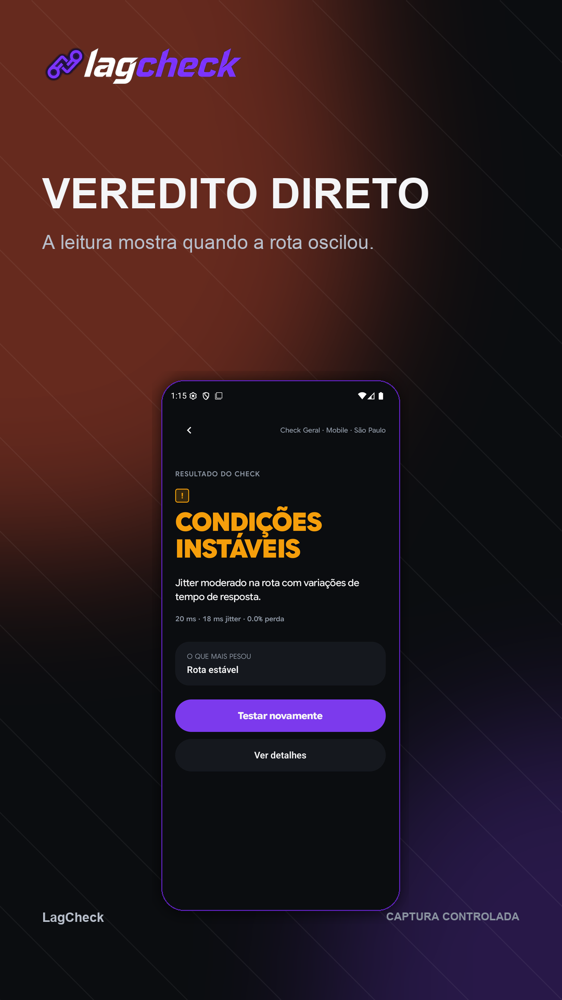
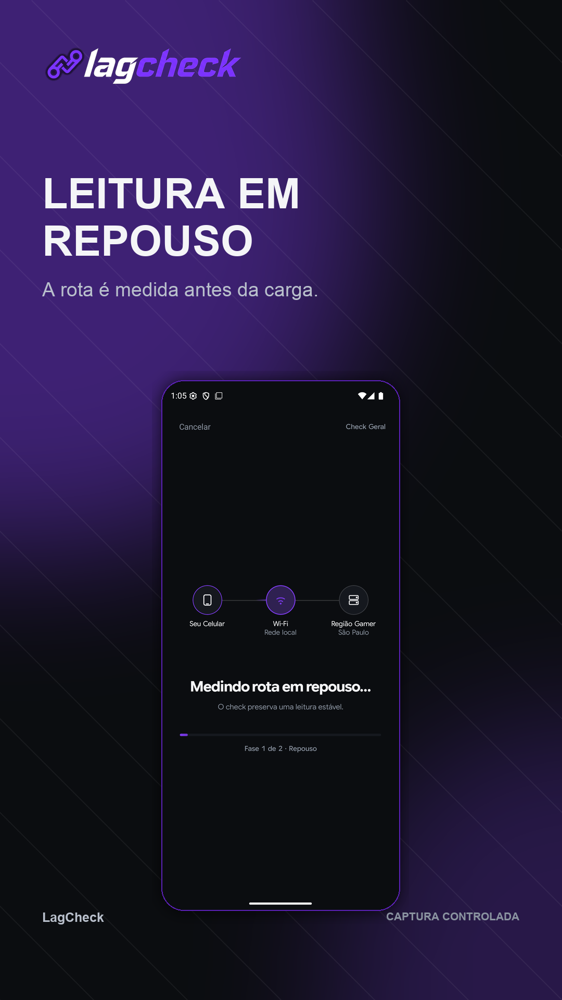
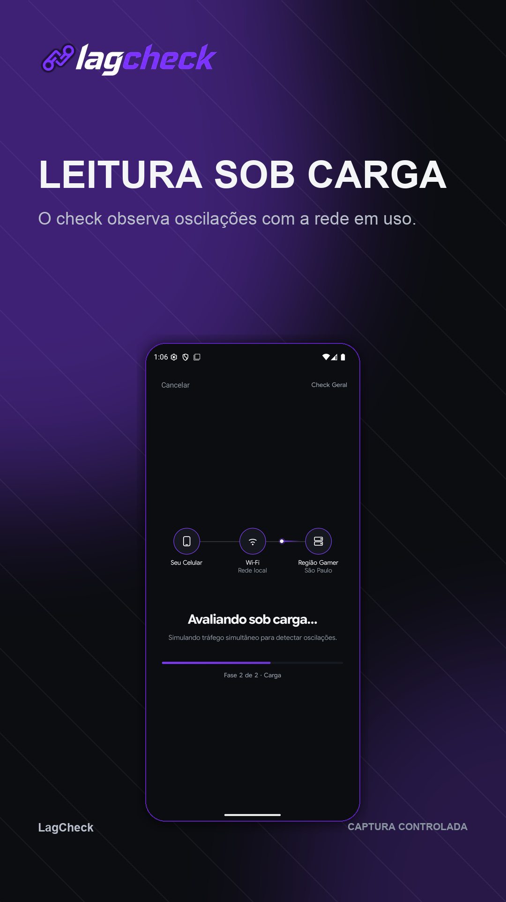
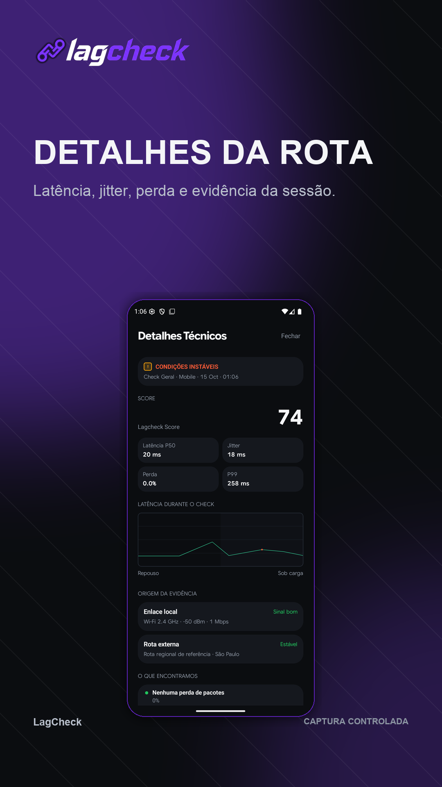

<p align="center">
  
</p>

<p align="center">
  <b>Sua conexão está boa para jogar agora?</b><br>
  O LagCheck mede a rota do seu celular até a infraestrutura do jogo e responde em uma frase.
</p>

<p align="center">
  <a href="https://apps.apple.com/app/id6818706960">App Store</a> ·
  <a href="https://groups.google.com/g/lagcheck">Testar no Android</a> ·
  <a href="https://lagcheck.signallq.com">Site</a> ·
  <a href="#english">English</a>
</p>

<p align="center">
  
  
  
  
</p>

> ⚠️ **Código visível, uso restrito.** Este repositório é público para transparência, mas **não tem licença de uso**. Todos os direitos reservados. Não copie, redistribua nem use o código, a marca ou os ativos sem avisar e receber autorização. Veja o [aviso de uso](NOTICE.md).

## O que é

Um app para jogador competitivo que quer saber, antes da partida, se a rede aguenta. Você escolhe o jogo, o LagCheck mede e entrega um veredito direto:

| Veredito | Significa |
| --- | --- |
| `● PRONTO PARA RANKED` | A conexão está estável para jogar. |
| `▲ CONDIÇÕES INSTÁVEIS` | Dá para jogar, mas pode oscilar. |
| `▲ EU EVITARIA RANKED AGORA` | A medição mostra problema. |
| `— INCONCLUSIVO` | Não deu para medir com confiança, então não inventamos nota. |

## Como funciona

- **Medição real, sem nota inventada.** Latência, jitter e perda de pacotes por UDP, em repouso e sob carga. Sem respostas válidas suficientes, o resultado é inconclusivo.
- **Score determinístico e versionado.** A mesma medição sempre dá o mesmo resultado, com vetores de teste.
- **Honesto sobre o limite.** Mede a rota do aparelho até uma infraestrutura de referência. Não promete o ping exato de um jogo, e para console ou PC o resultado é uma estimativa.
- **Custo zero e privacidade.** Catálogo de jogos local no app, sem assinatura. Telemetria anônima e mínima, sem dados pessoais nem IP.
- **Sem acusação sem prova.** O app só aponta roteador ou operadora quando há evidência.

## Plataformas

| Plataforma | Tecnologia | Pasta | Estado |
| --- | --- | --- | --- |
| iPhone (iOS 17+) | Swift, SwiftUI | [`Sources/`](Sources) | Na App Store |
| Android (API 26+) | Kotlin, Jetpack Compose | [`android/app/`](android/app) | Em teste (alpha e beta) |
| Windows | Kotlin, Compose Desktop | [`android/desktop/`](android/desktop) | Protótipo, [`windows-v0.1.0`](https://github.com/gmmattey/lagcheck/releases/tag/windows-v0.1.0) |
| Backend | Cloudflare Worker | [`worker/`](worker) | Em produção |

**Quer testar o Android?** Entre no [grupo de testadores](https://groups.google.com/g/lagcheck) para receber acesso ao teste alpha e beta.

O app Windows ainda não é um alvo oficial. É uma prévia.

## Rodando localmente

**iOS** (Xcode 16+)
```sh
open Nolaggy.xcodeproj
```
Escolha o target `Nolaggy` e rode no simulador. Testes: `Cmd + U`.

**Android** (JDK 21)
```sh
cd android
./gradlew assembleDebug
./gradlew test
```

**Windows (prévia)**
```sh
cd android
./gradlew :desktop:run
```

**Worker**
```sh
cd worker
npm install
npm test
```

> O nome `Nolaggy` em pastas e no projeto Xcode vem da marca anterior. A marca oficial é **LagCheck**.

## Estrutura

```text
Sources/        app iOS (SwiftUI) e motor de medição
Tests/          testes do motor e do catálogo
android/        app Android e prévia desktop (Windows)
worker/         Cloudflare Worker (carga do Deep Check e telemetria)
design-system/  tokens, ativos de marca e protótipos
docs/           especificação, arquitetura e decisões
store/          textos e criativos das lojas
marketing/      campanhas, vídeos e plano de crescimento
scripts/        automações de build e release
```

## Documentação

- [Funcional](docs/01-funcional.md): problema, jornada e regras de negócio
- [Arquitetura](docs/02-arquitetura.md) e [especificação técnica](docs/03-especificacao-tecnica.md)
- [Design system](docs/04-design-system.md): Dark Competitive UI
- [Voz do produto](docs/07-voz-do-produto.md)
- [Decisões](docs/DECISOES.md): registro único de todas as decisões do produto

## Contribuir e reportar problemas

Bugs e ideias entram como [issue](https://github.com/gmmattey/lagcheck/issues/new/choose). Antes de enviar código, leia o [CONTRIBUTING](CONTRIBUTING.md). Falhas de segurança seguem o [SECURITY](SECURITY.md).

## Sobre o fluxo de trabalho

O projeto é tocado por uma equipe pequena de agentes de IA com direção humana (Luiz). Os papéis e o ciclo estão em [`AGENTS.md`](AGENTS.md).

---

## English

**LagCheck** tells competitive mobile gamers whether their connection is good enough to play right now. It measures the route from the phone to a reference infrastructure using real UDP probes (latency, jitter, packet loss, at rest and under load) and returns a plain verdict. If there is not enough valid data, the result is *inconclusive*, never an invented score.

- iOS (SwiftUI) · Android (Kotlin/Compose) · Windows preview (Compose Desktop) · Cloudflare Worker backend
- Deterministic, versioned score. Console and PC results are labeled as estimates.
- Anonymous, minimal telemetry. No personal data, no IP.

**Source-available, all rights reserved.** There is no open-source license. Do not copy, redistribute or use the code, brand or assets without permission. See [NOTICE.md](NOTICE.md).
