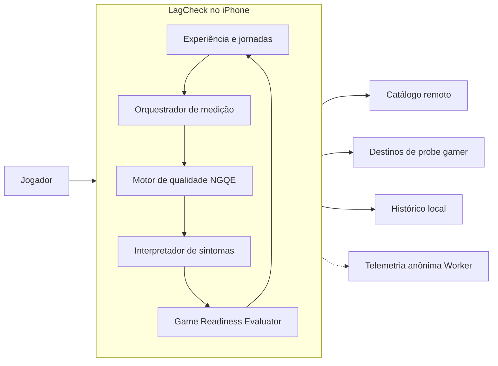
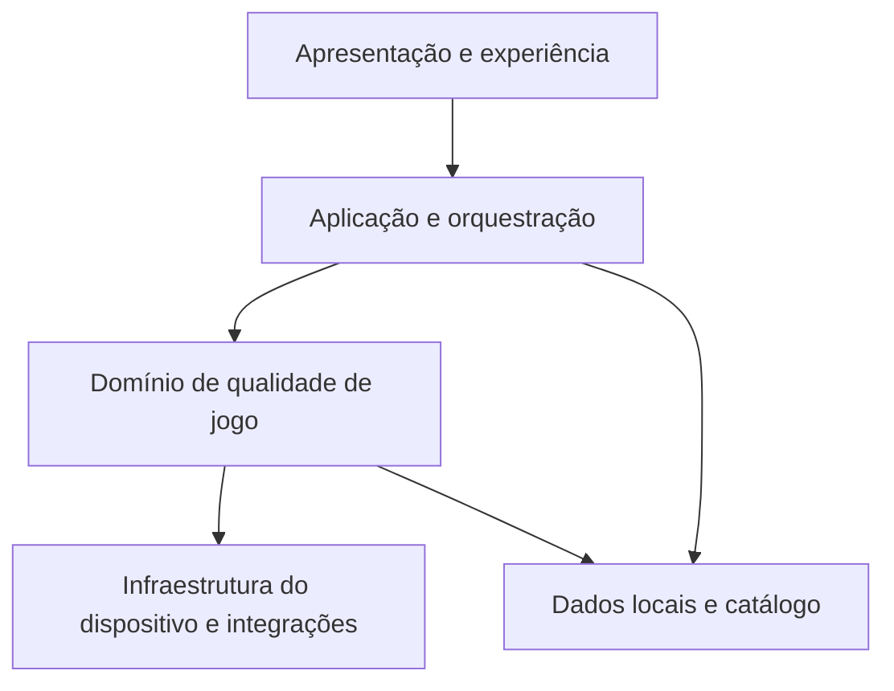
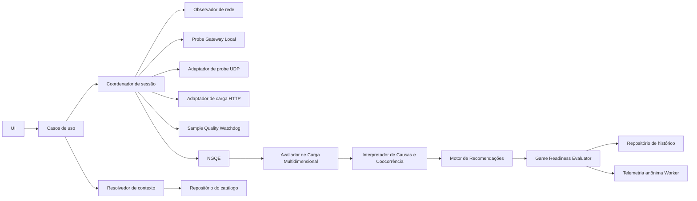
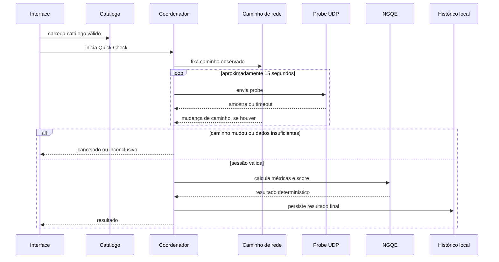

# LagCheck — arquitetura do MVP

**Status:** rascunho inicial para V1  
**Plataforma inicial:** iPhone (iOS 17 ou superior)  
**Documento relacionado:** [Documentação funcional](./01-funcional.md)

> **Decisões fechadas:** a distribuição iOS usa o Apple Developer Program já existente. Fora dessa conta, o MVP tem meta de custo operacional recorrente zero. O catálogo remoto e a telemetria mínima anônima de retenção são servidos por um Cloudflare Worker no plano gratuito, sem banco de dados complexo ou SDKs pagos.
> A App Store pode distribuir o app globalmente, mas o catálogo com suporte oficial do MVP começa em Brasil e Estados Unidos.
> AdMob, UMP e banners não entram no MVP1. A monetização por anúncios é recorte de MVP1.1 e só poderá introduzir biblioteca, IDs, consentimento e gates próprios nessa etapa.
> **Atualização Decisões 50 e 55:** O modelo de domínio incorpora o `GameReadinessEvaluator` produzindo `GameReadinessVerdict`, além de motores dedicados de integridade diagnóstica: `SampleQualityEvaluator`, `LoadImpactEvaluator` multidimensional (`deep-load-impact-v2`), `EvidenceRecommendationEngine` e probe isolado de gateway local (`en0`) para estrita separação entre instabilidade doméstica e rota externa. A telemetria remota mínima para validação de retenção é suportada via Worker (`POST /v1/telemetry`), sem PII nem armazenamento de IP.

## 1. Objetivo arquitetural

O LagCheck deve entregar uma avaliação confiável da experiência de jogo no iPhone com o mínimo de infraestrutura própria. A arquitetura privilegia medição no dispositivo, resultado determinístico, privacidade por padrão e evolução do catálogo sem publicação de uma nova versão.

O princípio central é simples: **o app mede; o catálogo orienta; o motor interpreta a prontidão da partida; o backend não arbitra cada teste**.

## 2. Visão do sistema

| Bloco | Responsabilidade | Não é responsabilidade |
| --- | --- | --- |
| App LagCheck | Experiência, coleta UDP, cálculo NGQE, diagnóstico e veredito de prontidão. | Depender de backend para calcular score ou arbitrar o veredito. |
| Catálogo remoto & Telemetria | Cloudflare Worker gratuito que publica `catalog.json`, serve carga em `/v1/load` e recebe telemetria anônima de retenção em `/v1/telemetry`. | Processar dados brutos de rede, PII, IPs ou decidir o resultado de uma sessão. |
| Destinos de probe | Responder às medições de rede permitidas para uma região. | Conhecer usuário, jogo selecionado ou persistir resultado. |

Não há conta obrigatória, servidor de speed test próprio, VPN, túnel de tráfego, banco remoto de histórico ou LLM no caminho crítico do MVP.

## 3. Camadas do aplicativo

### 3.1 Apresentação e experiência

Contém a Home focada em prontidão ("Vai jogar? Faça um Check"), tela de preparação ágil de jogo (`GameDetailView`), fluxo de medição com feedback limpo (`MeasurementProgressView`), tela de resultado orientada a veredito (`GameReadinessResultView` exibindo veredito semântico em 1º lugar, bloco honesto "O que encontramos" e métricas discretas), detalhes técnicos sob demanda (`TechnicalDetailsView` com P50/P95, spikes, dados sob carga e score 0–100), histórico de partidas e menu de configurações acessível por `…`.

Essa camada só apresenta estado pronto para uso. Ela não calcula métricas, escolhe endpoints, interpreta UDP nem aplica regras de classificação.

### 3.2 Aplicação e orquestração

Coordena os casos de uso: carregar catálogo, selecionar contexto de jogo, iniciar/cancelar uma sessão e persistir resultado.

O **Measurement Session Coordinator** é o dono do ciclo de uma medição. Ele:
- Garante que só exista uma sessão ativa por vez;
- Dispara o probe isolado de gateway local em Wi-Fi e os probes de rota remota;
- Monitora a qualidade da amostra via `SampleQualityEvaluator`, abortando precocemente em conexões degradadas;
- Reage instantaneamente a eventos do `NetworkPathObserver` (troca Wi-Fi ⇄ Celular), cancelando os sockets e descartando dados parciais da memória;
- Mantém o resultado parcial em repouso estritamente separado da fase sob carga.

### 3.3 Domínio de qualidade de jogo

É o núcleo determinístico, independente de tela, transporte ou fornecedor de endpoint. Inclui:

- Resolução do contexto de teste a partir de jogo, mercado, plataforma e catálogo;
- Agregação de amostras e watchdog de qualidade (`SampleQualityEvaluator`);
- Cálculo de P50, P95, P99, jitter, perda, spikes e latência de cauda ($P95/P50$);
- Classificação de spikes: isolados vs. recorrentes;
- Avaliação multidimensional sob carga (`LoadImpactEvaluator` com regra `deep-load-impact-v2`);
- Aplicação de pesos, limites e guardrails do perfil no motor NGQE;
- Hierarquia e coocorrência de causas pelo `ResultInterpreter` (causa primária e sintomas secundários);
- Motor de recomendações determinísticas (`EvidenceRecommendationEngine`, gerando de 1 a 3 ações práticas);
- Avaliação semântica de prontidão pelo `GameReadinessEvaluator` (`readiness-v2.0`), considerando confiança de rota;
- Geração do LagCheck Score (0–100) determinístico mantido para detalhes, histórico e telemetria.

O domínio recebe dados de entrada tipados e devolve um resultado completo. Não acessa UI, armazenamento, HTTP, UDP nem estado global do iOS.

### 3.4 Infraestrutura do dispositivo e integrações

Implementa adaptadores para capacidades externas:

- Descoberta dinâmica de gateway local via rotas do sistema operacional (`sysctl`/`getifaddrs` na `en0`), sem assumir IP `.1`;
- Transporte UDP para probes no gateway local (5 probes, 200 ms timeout) e detecção de estado observável/não-observável;
- Transporte UDP para probes remotos em destinos AWS GameLift, Azure PlayFab ou Valve;
- Carga HTTP controlada do Check (Worker `/v1/load`, teto de 10 MB);
- Diagnóstico de banda Wi-Fi com níveis de confiança (`WiFiBandDetector`: `.high`, `.medium`, `.low`, `.unknown`);
- Cliente leve de STUN RFC 5389 para detecção de topologia de NAT;
- Observação contínua de caminho de rede via `NWPathMonitor` para descarte imediato em transição de interface;
- Telemetria de produto anônima enviada ao Worker (`/v1/telemetry`) para validação de retenção sem PII/IP;
- Acesso a armazenamento local (SwiftData);
- Cliente de catálogo remoto e validação de assinatura Ed25519.

Esses adaptadores obedecem contratos definidos pelo domínio e pela aplicação. Trocar um destino de probe não pode alterar a regra de score ou prontidão.

### 3.5 Dados locais e catálogo

Há duas famílias de dados:

| Família | Origem | Uso | Regra de retenção inicial |
| --- | --- | --- | --- |
| Configuração de catálogo | Base embarcada no app, atualizada remotamente e com cache local. | Jogos, regiões, perfis, limites, textos parametrizados e flags. | Atualizar no máximo a cada 24 h; usar última versão válida por até 30 dias; depois, voltar à base embarcada. |
| Dados do jogador | Criados no dispositivo em SwiftData. | Preferências, último jogo/plataforma e histórico de vereditos. | Permanecem locais por até 90 dias, com máximo de 100 medições por jogo e exclusão manual nas configurações. |

O histórico armazena o resultado contextualizado e a versão das regras usadas: jogo, plataforma, tipo de rede (`.wifi` ou `.cellular`), gateway probe result (`.stable`, `.degraded`, `.unobservable`), região, estratégia de medição, confiança, métricas agregadas, veredito de prontidão, score, causa primária, causas secundárias, recomendações geradas e versão das regras (`readiness-v2.0`, `deep-load-impact-v2`).

## 4. Componentes e fronteiras

| Componente | Dono | Entrada | Saída |
| --- | --- | --- | --- |
| Repositório do catálogo | Dados | Configuração remota/cache | Catálogo válido e versionado ou indisponibilidade explícita. |
| Resolvedor de contexto | Domínio | Jogo, mercado, plataforma e catálogo | Perfil, regiões, alvo, confiança e regras aplicáveis. |
| Coordenador de sessão | Aplicação | Contexto resolvido e intenção de Check | Estado de sessão, cancelamento ou amostras finalizadas. |
| Observador de rede | Infraestrutura | Estado do caminho de rede | Evento de mudança de interface que descarta a sessão. |
| Probe Gateway Local | Infraestrutura | Gateway dinâmico resolvido | RTT/loss local ou marcação de `.unobservable`. |
| Adaptador de probe UDP | Infraestrutura | Alvo e plano de amostragem | Amostras válidas, timeouts ou falha de transporte. |
| Adaptador de carga HTTP | Infraestrutura | Cenário de carga | Sinal de carga e métricas de transferência. |
| Watchdog de qualidade | Domínio | Amostras iniciais de UDP | Confirmação de qualidade ou abort precoce. |
| NGQE | Domínio | Amostras, perfil e regras | Métricas calculadas, score 0–100 e guardrails aplicados. |
| Avaliador de carga | Domínio | Amostras de repouso e carga | Classificação de materialidade (`deep-load-impact-v2`). |
| Interpretador de causas | Domínio | Métricas, delta de carga e probe local | Causa primária e sintomas secundários objetivos. |
| Motor de recomendações | Domínio | Causa primária e sintomas confirmados | 1 a 3 ações práticas ordenadas por impacto. |
| Game Readiness Evaluator | Domínio | Métricas, sintomas, perfil e confiança | `GameReadinessVerdict` (`.ready`, `.caution`, `.notReady`, `.inconclusive`). |
| Repositório de histórico | Dados | Veredito, regras e métricas | Histórico local por jogo no SwiftData. |
| Telemetria de retenção | Infraestrutura | Eventos de ciclo (start, verdict, retest) | Evento anônimo enviado a `/v1/telemetry`. |

## 5. Fluxos arquiteturais críticos

### 5.1 Quick Check

O estado parcial alimenta somente a tela durante o teste. Score, classificação, causa e recomendação são calculados uma única vez no término de uma sessão válida.

### 5.2 Deep Check (Wi-Fi e Rede Móvel)

O Deep Check reutiliza a resolução de contexto do Quick Check e opera tanto em **Wi-Fi** quanto em **rede móvel** (Decisão 36). Em rede móvel, o início da fase de carga exige consentimento explícito do usuário, informando o limite máximo de dados (até 10 MB). Ele divide a sessão em duas distribuições independentes:

1. fase de repouso, com probes UDP;
2. fase sob carga controlada, com probes UDP simultâneos a uma transferência HTTP controlada de até 10 MB.

Cada fase dura 15 segundos, totalizando aproximadamente 30 segundos, e executa até dois probes UDP por segundo.

O NGQE recebe ambas as séries separadas e calcula a degradação. Na fase de repouso, o Deep Check também compara a região primária com uma alternativa quando o catálogo a disponibilizar; a fase sob carga continua na região primária. O score principal representa somente a fase de repouso; a fase de carga produz um indicador separado de impacto sob carga. Uma falha de carga não invalida automaticamente as amostras de repouso, mas impede uma conclusão sobre comportamento sob carga e precisa aparecer como limitação do resultado.

Qualquer transição de caminho de rede durante a sessão (Wi-Fi ➔ celular ou celular ➔ Wi-Fi) aciona cancelamento imediato pelo `NetworkPathObserver` e descarte total de dados parciais. O histórico registra o tipo de conexão utilizado (`.wifi` ou `.cellular`), sem comparação automatizada entre elas.

### 5.3 Catálogo offline ou inválido

O app tenta atualizar o catálogo antes de começar um teste, sem impedir a abertura da Home, e no máximo uma vez a cada 24 horas. Se não houver conexão, pode usar o último catálogo local válido por até 30 dias. Depois desse prazo, retorna ao catálogo-base embarcado no app. Sem um catálogo válido aplicável ao jogo/contexto, o teste não começa; a UI explica que a configuração do jogo não está disponível no momento.

O catálogo é tratado como entrada não confiável até passar por validação de esquema, versão, regras de negócio e assinatura criptográfica Ed25519. O app só aceita um `catalog.json` cuja assinatura corresponda à chave pública embarcada; a chave privada de publicação nunca vai para o aplicativo. Um catálogo malformado, corrompido ou com assinatura inválida não pode sobrescrever a última versão válida nem derrubar o app.

### 5.3 Seleção de mercado, região e assets de catálogo

O app usa localidade/região do sistema apenas para ordenar candidatos de mercado publicados no catálogo. Dentro de uma sessão, o coordenador cria snapshot imutável do catálogo validado e faz pré-leitura UDP somente contra regiões candidatas declaradas nele. Mercado e região efetivos são resolvidos por essa pré-leitura ou por override manual explícito; viagem, VPN ou configuração regional do aparelho não autorizam fixar contexto por localidade. Não há GPS, geocodificação, IP geolocation nem destino obtido fora do catálogo. Sem candidato confirmado, não há medição nem score. A regra canônica está em [Decisão de seleção regional automática](./16-decisao-selecao-regional-automatica.md).

> **Substituído para a V1:** os três parágrafos abaixo descrevem o pipeline de assets remotos assinados como estava previsto originalmente. A [Decisão de identidade visual neutra dos jogos](./18-decisao-identidade-visual-neutra-de-jogos.md) substitui esse pipeline para a V1: não há asset remoto, URL, hash ou cache de imagem por jogo no catálogo assinado atual. A miniatura é um componente neutro do design system, sem mapeamento por jogo. O texto abaixo permanece como referência para uma eventual reintrodução de arte licenciada, mediante nova decisão.

O catálogo assinado pode referenciar assets remotos de jogos por URL HTTPS, hash de conteúdo, tipo MIME e limite de tamanho. A assinatura autoriza a referência; o app ainda valida esquema, host permitido, HTTPS, hash e limites antes de disponibilizar a imagem para a UI. Nenhuma tela interpreta URL ou JSON remoto diretamente.

O cache de imagens é separado do cache do catálogo: apagar, expirar ou falhar uma imagem não invalida um contexto de medição já válido. O cache do catálogo continua válido por até 30 dias; imagens podem ser descartadas antes por pressão de armazenamento, expiração HTTP ou troca de hash. A Home abre com o último catálogo válido e placeholders neutros para imagens ausentes, iniciando atualização de catálogo e assets em segundo plano sem bloquear a navegação ou uma medição válida.

O Worker publica duas rotas públicas: `/v1/catalog.json` e `/v1/load`. O catálogo contém metadados de versão e validade, jogos, perfis de score e regiões/destinos de probe. A rota de carga entrega até 10 MB sem cache e só é usada pelo Deep Check em Wi-Fi. Não há API autenticada, banco de dados ou endpoint individual por jogo no MVP.

Enquanto não houver domínio próprio, o Worker usa uma URL `workers.dev` gratuita como endpoint temporário do catálogo. Ela não é exposta na interface; o catálogo-base embarcado e a validação de assinatura preservam o funcionamento se esse endpoint falhar. Quando existir domínio próprio, a URL é substituída sem mudar o contrato ou o aplicativo.

### 5.4 Publicidade no MVP1.1

O MVP1 não contém publicidade: não há AdMob, UMP, banner, consentimento de anúncios, IDs de unidade ou espaço reservado na interface. A eventual entrada no MVP1.1 será uma decisão separada, com contrato de privacidade, revisão de design e gates de release próprios; jamais poderá interferir em medição, score, resultado ou histórico.

## 6. Contratos arquiteturais

Os contratos detalhados serão formalizados na especificação técnica. Nesta camada, valem estas garantias:

| Contrato | Garantia |
| --- | --- |
| `GameCatalogRepository` | Entrega somente catálogo validado, assinado, versionado e aplicável ou erro explícito. |
| `MeasurementTransport` | Entrega amostras, timeouts e erros de transporte sem calcular métricas. |
| `NetworkPathObserver` | Informa mudança relevante de caminho durante uma sessão; não mistura estados. |
| `QualityEvaluator` | Produz sempre o mesmo resultado para o mesmo conjunto de amostras e perfil. |
| `ResultInterpreter` | Traduz resultado técnico em sintomas honestos observados. |
| `GameReadinessEvaluator` | Arbitra a decisão semântica de prontidão de partida (`GameReadinessVerdict`) a partir dos sintomas e perfil do jogo. |
| `HistoryRepository` | Persiste somente resultados finais, veredito e contexto necessário para interpretá-los depois. |

O MVP não possui fallback HTTP ou ICMP para um destino UDP bloqueado. Quando o transporte não gera as 10 respostas válidas mínimas, a sessão termina como inconclusiva e mantém a semântica de medição gamer intacta.

## 7. Privacidade e segurança por desenho

- Resultados e histórico são locais por padrão.
- O teste não exige login, identificador pessoal nem envio de cada amostra para um servidor próprio.
- O catálogo não inclui dados pessoais nem permite texto livre que altere a interpretação técnica.
- A comunicação com catálogo e serviços auxiliares usa canais seguros; a implementação define autenticação de conteúdo, cache e estratégia de atualização.
- O aplicativo não tenta descobrir, escanear ou atacar servidores de jogos. Só usa destinos permitidos e configurados no catálogo.
- A telemetria mínima de produto para validação de retenção (Decisão 50) envia apenas um ID de instalação aleatório e eventos de funil a `/v1/telemetry`, sem endereço IP, amostras de rede brutas ou dados de conta.

## 8. Evolução sem reescrita

### 8.1 Novos destinos de probe

O domínio trabalha com uma abstração de alvo de medição. Um destino oficial, infraestrutura de jogo, proxy regional gamer ou destino genérico são variações configuráveis de estratégia. É possível adicionar novos provedores de probe sem mudar fórmula, telas ou histórico.

### 8.2 Android futuro

A versão Android futura deverá preservar os contratos de catálogo, métricas, NGQE, resultado e histórico. Os adaptadores de transporte, observação de rede, persistência e apresentação serão específicos da plataforma.

Não há premissa de código compartilhado no MVP iPhone. A portabilidade vem dos contratos, catálogo versionado e comportamento determinístico, não de uma escolha prematura de framework multiplataforma.

### 8.3 Operação em Wi-Fi e celular
 
Com a Decisão 36, o Check Completo opera tanto em Wi-Fi quanto em rede celular (com consentimento prévio para a carga HTTP de até 10 MB). Na V1, uma mudança de caminho durante a sessão cancela imediatamente a medição sem persistência parcial; o app não inicia comparação automatizada entre redes diferentes e nunca trata resultado de Wi-Fi e rede móvel como equivalentes.

### 8.4 Monetização futura

Qualquer monetização, inclusive publicidade prevista para MVP1.1, é uma camada de aplicação. Ela não deve alterar o domínio de medição ou score e não integra o MVP1.

## 9. Requisitos arquiteturais de qualidade

| Qualidade | Diretriz |
| --- | --- |
| Confiabilidade e Integridade | Sessões são canceladas ou inconclusivas quando os dados não permitem conclusão honesta. Diagnósticos causais exigem medição isolada real; o app nunca acusa o Wi-Fi ou a operadora sem evidência comprovada (Decisão 50). |
| Desempenho | Cálculo local e incremental; o resultado não espera um backend. |
| Resiliência | Cache de catálogo válido e recuperação clara de erro de rede. |
| Testabilidade | NGQE, resolvedor, interpretador e `GameReadinessEvaluator` são puros/independentes de UI e transportes. |
| Observabilidade | Telemetria anônima, enxuta e sem PII/IP via Cloudflare Worker existente (`POST /v1/telemetry`) para mensurar retenção e reteste real entre sessões (Decisão 50). |
| Evolução | Perfis e catálogo versionados; adaptadores substituíveis. |
| Acessibilidade e idioma | Toda conclusão e estado relevante funciona em PT-BR e inglês; localização não modifica regras de score. |

## 10. Decisões em aberto antes da especificação técnica
