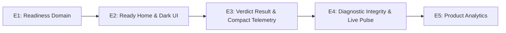

# LagCheck — Decisão 50: Reposicionamento do MVP — Ready for Ranked

**Status:** decidido pelo Dono do Produto; em especificação e implementação  
**Data:** 25 de setembro de 2026  
**Responsáveis:** Luiz (produto), Marco (produto), Renan (design), Rian (iOS), Iury (rede)  
**Consolida e revisa:** decisões 01, 02, 03, 07, 24, 34, 35, 36, 42, 43, 46, 47, 48 e 49.

---

## 1. Visão Geral e Racional Estratégico

Uma revisão completa da base de código do LagCheck na branch `main` confirmou que **não é necessário reconstruir o LagCheck**. A base técnica existente (motor UDP de medição, execução sob carga, catálogo remoto assinado, resolução regional automática, histórico em SwiftData e arquitetura modular) é sólida e já antecipava a essência da proposta de valor, como registrado na Decisão 42: *“A Home responde primeiro à pergunta ‘posso jogar agora?’”*.

No entanto, o produto acumulou complexidade e ruído secundário (score de 0–100 protagonista, trilhas causais que prometem mais do que medem, dicas com IA/Gemini no fluxo crítico, Conexão Geral disputando com jogos e navegação pesada com 4 abas).

A direção agora é concluir o movimento de simplificação radical e focar o LagCheck no que ele faz de melhor: **responder instantaneamente se a conexão está pronta para uma partida competitiva (Ready for Ranked).**

---

## 2. A Nova Jornada Alvo

### Jornada Atual (Complexa)
```text
Home → Jogo → Plataforma → Conexão do Equipamento → Deep Check → Score (64pt) → Trilha Causal → Detalhes/Otimizar IA
```

### Nova Jornada Direta (Ready for Ranked)
```text
Home → Jogo → CHECK → VEREDITO
                          └─→ (Opcional: "Entender resultado" / Por quê? → Diagnóstico → Detalhes Técnicos)
```

### Para Usuário Recorrente
```text
Abriu o app → Último jogo já selecionado → CHECK → VEREDITO
```

---

## 3. Matriz Decisória de Componentes

| Componente | Decisão | Ação Estratégica |
|---|---|---|
| **Catálogo de jogos remoto** | **MANTER** | Mantém diferenciação por plataforma, tipo de rota, confiança e referência regional. |
| **Catálogo assinado / Cloudflare Worker** | **MANTER** | Preserva atualizações de infraestrutura e jogos sem submissão de release à App Store. |
| **Títulos competitivos (Valorant, CS2, LoL, Fortnite etc.)** | **MANTER** | Não limitar tecnicamente a três jogos; priorizar visualmente na validação. |
| **Deep Check** | **MANTER + RENOMEAR** | Motor técnico mantido. Na interface passa a se chamar unicamente **Check**. "Deep" é detalhe interno. |
| **UDP / ping / jitter / loss / spikes** | **MANTER** | Combustível do veredicto; deixa de ser protagonista visual. |
| **Teste sob carga** | **MANTER** | Diferencial indispensável para flagrar degradação sob uso da rede. |
| **Seleção regional automática** | **MANTER** | Resolução transparente, invisível e automática pelo motor. |
| **Histórico SwiftData** | **MANTER + ALTERAR** | Apresenta histórico de prontidão/jogo (Ready/Caution/Not Ready), e não coleção de scores técnicos. |
| **Plataforma (PC/PS/Xbox/iPhone)** | **MANTER** | Essencial para modular o contexto de interpretação da rede. |
| **Declaração Wi-Fi/Ethernet do equipamento** | **MANTER + SIMPLIFICAR** | Lembra última escolha feita por jogo; pergunta apenas quando estritamente necessário. |
| **Home atual** | **ALTERAR** | Focada em "Vai jogar? Faça um Check", destacando o último jogo testado e CTA primário. |
| **Game Detail** | **ALTERAR** | Tela de preparação ultra-curta: confirmação ágil e Check imediato. |
| **Resultado** | **ALTERAR MUITO** | Veredicto semântico em 1º lugar. O Score 0–100 sai do topo. |
| **Score 0–100** | **ESCONDER** | Permanece calculado no domínio para histórico e telemetria, visível somente em detalhes. |
| **Métricas técnicas (ms, %)** | **ESCONDER** | Apresentadas discretamente ou após expandir "Entender resultado / Ver detalhes". |
| **Connection Booster / Gemini (IA)** | **ESCONDER** | Código preservado, mas removido da jornada principal do MVP até validação de hipótese. |
| **"Otimizar conexão"** | **ESCONDER** | Não bloquear nem distrair da resposta de prontidão. |
| **Região manual em Ajustes** | **ESCONDER/AVANÇADO** | A determinação da melhor rota é dever do motor. |
| **Conexão Geral para Jogos** | **ALTERAR** | Atua como fallback no empty state de busca ("Não encontrou seu jogo? Fazer Check Geral"), não competindo na Home. |
| **Abas Histórico e Ajustes** | **ESCONDER da tab bar** | Acesso contextual na Home ("Últimos checks ›") e Ajustes via menu `…`. |
| **Tabs da Interface** | **ALTERAR** | Redução de 4 abas para apenas 2: **Início \| Jogos**. |
| **Nomenclatura QuickCheck** | **REMOVER gradualmente** | Limpeza de dívida técnica (`QuickCheckFeatureView`, chaves legadas). |
| **Trilha da rota** | **ALTERAR URGENTE** | Eliminar alegação de causalidade falsa. Apresentar "O que encontramos" sem fingir saber onde foi o gargalo. |
| **IA no veredicto principal** | **REMOVER do MVP** | Veredicto 100% determinístico, reproduzível e auditável. |
| **Ready/Ranked Verdict** | **CRIAR** | Nova camada semântica principal do produto (`GameReadinessVerdict`). |
| **Cause Check** | **CRIAR** | Explicar primeiro *o que* deu errado; apontar *onde* apenas quando houver evidência real. |
| **Telemetria de produto mínima** | **CRIAR** | Métricas remotas anônimas via Cloudflare Worker existente para mensurar retenção e reteste real. |

---

## 4. Quatro Descobertas Técnicas e Correções Críticas

### 4.1. O resultado atual está hierarquicamente invertido
- **Diagnóstico:** `CheckCompletoResultView` coloca um badge de score de `64 pt` em destaque central e subordina o veredicto verbal.
- **Correção:** O veredicto passa a ser o protagonista absoluto:
  - Exemplo 1: **PRONTO PARA JOGAR** — *“Sua conexão está estável para Valorant agora.”* (seguido discretamente por: `28 ms · 2 ms jitter · 0% perda`).
  - Exemplo 2: **EU EVITARIA RANKED AGORA** — *“Detectamos perda de pacotes durante o teste.”* (seguido por: `Perda de pacotes · 3,2%`).

### 4.2. Falha de integridade na "Trilha Causal"
- **Diagnóstico:** Em `CheckCompletoResultEvaluator.evaluateTrail()`, o estado local da rede (`networkState = .check`) é marcado como saudável sempre que a medição é concluída, sugerindo que o iPhone e o Wi-Fi foram auditados e inocentados, mesmo sem medição isolada de cada segmento.
- **Correção:** Eliminar alegações causais que o teste não consegue provar. Substituir a trilha por um bloco honesto:
  - **O QUE ENCONTRAMOS**
    - Perda de pacotes: 🔴 Detectada / 🟢 Nenhuma
    - Estabilidade: 🟡 Oscilando / 🟢 Estável
    - Sob uso da internet: 🟢 Estável / ⚠️ Degradação
    - Destino testado: São Paulo · referência regional

### 4.3. Correção do diagnóstico de Wi-Fi local antes de virar Cause Check
- **Diagnóstico:** `WiFiLocalGatewayProber` assume que o gateway é sempre `.1` na subnet local e envia pacotes UDP para a porta 53, medindo apenas o tempo de término do envio no socket, sem aguardar resposta RTT do roteador. Adicionalmente, `WiFiBandEvaluator` recebe o RTT e jitter da medição externa (remota) e infere instabilidade de 2.4 GHz, confundindo oscilações da WAN com o Wi-Fi doméstico.
- **Correção:** Proibir terminantemente rotular o Wi-Fi local como culpado definitivo até que haja um probe com resposta confirmada do gateway. Não usar RTT externo para classificar a banda Wi-Fi.

### 4.4. Telemetria remota mínima para validação de retenção
- **Diagnóstico:** O app usa `OSLogAnalyticsTracker`, gravando eventos no `os.Logger` do dispositivo. Isso impede saber se os usuários retornam ao produto dias depois (reteste, retenção semanal).
- **Correção:** Criar endpoint enxuto no Cloudflare Worker existente (`POST /v1/telemetry`) para receber eventos anônimos sem PII, sem IP e sem persistência invasiva. Apenas: `installation_id` anônimo, nome do evento (`app_open`, `check_started`, `verdict_viewed`, `retest_started`), jogo e veredicto.

---

## 5. Nova Camada de Domínio: `GameReadinessVerdict`

O modelo de domínio ganha uma camada semântica explícita de prontidão competitiva, posicionada acima do `QualityResult`:

```text
Medição UDP (Repouso + Carga)
        ↓
   QualityResult (Métricas, P50, Perda, Jitter, Spikes)
        ↓
 ResultInterpreter
        ↓
GameReadinessEvaluator
        ↓
GameReadinessVerdict (.ready, .caution, .notReady, .inconclusive)
```

### Estados do Veredito:
1. **`READY` (Pronto para jogar):** Condições observadas compatíveis com partida competitiva sólida.
2. **`CAUTION` (Atenção / Condições instáveis):** Jitter moderado, oscilações esporádicas ou impacto sob carga.
3. **`NOT_READY` (Evitaria Ranked agora):** Perda de pacotes detectada, latência imprópria para o perfil do jogo ou instabilidade severa.
4. **`INCONCLUSIVE` (Dados insuficientes):** Sem respostas UDP suficientes para emitir veredicto seguro.

> **Revisão de Regra Anterior:** A restrição técnica histórica que proibia o termo textual "Pronto para jogar" é formalmente revisada. O termo é permitido quando ancorado em evidência UDP determinística, acompanhado da moderação no sentido de recomendação situacional (ex.: "Pronto para jogar", "Eu evitaria Ranked agora").

---

## 6. Navegação e Arquitetura de Telas

1. **Tab Bar de 2 Abas:**
   - **Início:** Estado atual, último jogo testado, ação rápida de Check, histórico contextual ("Últimos checks ›") e menu `…` para Ajustes.
   - **Jogos:** Catálogo completo com busca.
2. **Fallback da Conexão Geral:**
   - O item `"generic-gaming"` deixa de concorrer como destaque de catálogo na Home.
   - Aparece como assistência amigável no empty state de busca na aba Jogos: *“Não encontrou seu jogo? Fazer Check Geral”*.

---

## 7. Iniciativa Unificada: `Lagcheck Competitive Redesign + Ready Check`

Para garantir coesão e evitar retrabalho, o reposicionamento funcional (Decisão 50) e a nova direção visual **Dark Competitive UI** (Decisão 51) são executados conjuntamente sob a iniciativa unificada:

**`Lagcheck Competitive Redesign + Ready Check`**

O escopo do novo MVP é delimitado rigorosamente nas prioridades P0 e P1, distribuído em 5 entregas sequenciais (E1 a E5) já incorporando a nova linguagem visual e de produto:



- **E1 — Readiness Domain (P0):**
  - Criação do `GameReadinessVerdict` e `GameReadinessEvaluator`.
  - Mapeamento determinístico por perfil de jogo e bateria de testes de vetores.
- **E2 — Ready Home & Dark Competitive UI (P0/P1):**
  - Reestruturação da Home focada em "PRONTO PRA JOGAR?" com grande artwork do jogo e CTA Coral Solar dominante `[ FAZER CHECK ]`.
  - Memorização e seleção instantânea do último jogo/plataforma.
  - Tab Bar simplificada para 2 abas (Início \| Jogos).
  - Adoção dos tokens Dark Competitive (fundo quase preto, superfícies grafite, bordas finas).
- **E3 — Verdict Result & Compact Telemetry (P0):**
  - Remodelagem da tela de resultado com veredicto em destaque absoluto (`● PRONTO PARA RANKED` / `▲ EU EVITARIA RANKED AGORA`).
  - Painel compacto de telemetria com labels em caixa alta (`PING`, `JITTER`, `PERDA`).
  - Barra contínua de estabilidade e bloco honesto "O que encontramos".
  - Ocultação do Connection Booster/Gemini na jornada primária.
- **E4 — Diagnostic Integrity & Live Pulse (P0/P1):**
  - Tela de Check com pulso central dinâmico de sinal `───╲_╱──╲_╱──` e micro-telemetria rotativa.
  - Correção/desativação de inferências inválidas de gateway `.1` e desacoplamento de RTT remoto na análise Wi-Fi.
- **E5 — Product Analytics (P0):**
  - Instrumentação de telemetria anônima enxuta no Worker (`POST /v1/telemetry`) para acompanhamento de retenção e retestes.

**Critério de Conclusão do MVP:** Finalizadas as entregas P0 e P1 (E1 a E5), o desenvolvimento de novas features fica congelado até a obtenção de evidências quantitativas de retenção de usuários.
