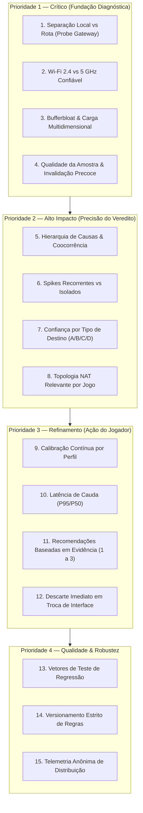

# LagCheck — Decisão 55: Especificação de Melhorias em Diagnóstico, Métricas e Integridade de Rede

**Status:** decidido pelo Dono do Produto (Luiz) e integrado por Marco; em especificação e implementação  
**Data:** 26 de setembro de 2026  
**Responsáveis:** Marco (produto), Iury (rede), Rian (iOS), Renan (design), Luiz (aprovação de produto)  
**Consolida, revisa e detalha:** decisões 01, 02, 03, 27, 32, 36, 50 e 51.  
**Iniciativa correlata:** `Lagcheck Competitive Redesign + Ready Check` (Decisões 50/51)

---

## 1. Contexto e Racional

O reposicionamento do LagCheck na Decisão 50 estabeleceu o princípio de **Integridade Diagnóstica**: é terminantemente proibido culpar roteadores domésticos ou operadoras sem evidência matemática e isolada. O produto responde primariamente *"Posso jogar competitivo agora?"* (`GameReadinessVerdict`), seguido de *"O que encontramos"* (sintomas honestos) e *"Entender resultado"* (detalhes técnicos sob demanda).

A auditoria diagnóstica e métrica do Grok (versão 1.0, 26/09/2026) identificou 15 pontos de aprimoramento essenciais para elevar a precisão do diagnóstico, mitigar falsos positivos/negativos e transformar sintomas em recomendações acionáveis. Esta decisão formaliza o contrato funcional, técnico e arquitetural desses 15 pontos, organizados nas 4 prioridades aprovadas.

---

## 2. As 4 Prioridades e os 15 Itens Decididos

---

### PRIORIDADE 1 — Crítico

#### Item 1: Separação Clara Local vs Rota (Probe Isolado de Gateway)
- **Problema:** Risco de culpar o Wi-Fi quando a oscilação ocorre na operadora, ou vice-versa.
- **Decisão Técnica (Iury & Rian):**
  - O gateway padrão do Wi-Fi deve ser resolvido via tabela de roteamento do sistema (`sysctl`/`getifaddrs` na interface ativa `en0`), nunca assumindo IP fixo `.1`.
  - Executar probe isolado no gateway local antes ou em paralelo aos primeiros probes da rota remota.
  - O probe local consiste em 5 datagramas UDP curtos (ex: eco ou requisição de controle com timeout de 200 ms por probe).
  - Se o gateway não responder (firewall doméstico fechado para UDP local): marcar estado do gateway como **não observável** (`.unobservable`), nunca inferindo falha local.
  - Critério de culpa local: Só declarar problema no enlace doméstico se o RTT local estiver elevado (>15 ms em Wi-Fi típico), ou houver perda/jitter local mensurável. Caso contrário, qualquer instabilidade é atribuída à **rota externa / operadora**.

#### Item 2: Diagnóstico de Frequência Wi-Fi Confiável (2.4 GHz vs 5 GHz)
- **Problema:** Inferir banda Wi-Fi a partir de ping remoto gera erros graves.
- **Decisão Técnica (Iury & Rian):**
  - A avaliação de banda Wi-Fi só pode utilizar uma fonte pública válida de metadados de enlace do sistema. O candidato atual não dispõe dessa fonte; não se usa SSID, RTT, jitter, perda ou heurística de PHY rate como substituto.
  - Classificar a detecção em níveis de confiança: `.high`, `.medium`, `.low`, `.unknown`.
  - Se `.unknown` ou `.low`: o app **não afirma a banda** nem exibe avisos falsos.
  - Se `.high` ou `.medium` e banda for 2.4 GHz em jogo de perfil competitivo (`BATTLE_ROYALE_COMPETITIVE` / `MOBILE_REALTIME`): emitir sintoma informativo e recomendação prioritária de troca para 5 GHz, modulando veredito para `.caution` se acompanhado de jitter.

#### Item 3: Bufferbloat / Impacto sob Carga Multidimensional e Parametrizado
- **Problema:** Limiar fixo de +20 ms em P50 é rígido e ignora outros sintomas de estresse (jitter, perda, spikes).
- **Decisão Técnica (Iury):**
  - Nova regra `deep-load-impact-v2` parametrizada por `GameProfile`:
    - `BATTLE_ROYALE_COMPETITIVE`: Delta P50 material $\ge 15$ ms; severo $\ge 35$ ms.
    - `MOBILE_REALTIME`: Delta P50 material $\ge 25$ ms; severo $\ge 50$ ms.
    - `CASUAL_REALTIME`: Delta P50 material $\ge 40$ ms; severo $\ge 80$ ms.
  - Avaliação multidimensional: Além do delta P50, a degradação sob carga avalia:
    - Delta de jitter sob carga ($> 10$ ms adicionais = material).
    - Perda de pacotes induzida por carga ($> 2\%$ adicional = material/severo).
    - Spikes sob carga ($> 2$ spikes adicionais = material).
  - Classificação formal: `.none`, `.light` (descritivo), `.material`, `.severe`.

#### Item 4: Mínimo de Amostras e Qualidade da Amostra (Invalidação Precoce)
- **Problema:** Aguardar 15 s quando a conexão está nitidamente morta ou instável a ponto de invalidar o teste.
- **Decisão Técnica (Iury & Rian):**
  - Regra de mínimo mantida: $\ge 10$ respostas UDP válidas para qualquer veredito conclusivo.
  - Invalidação precoce / Watchdog de qualidade:
    - Se houver $\ge 4$ timeouts consecutivos nos primeiros 6 probes: abortar antecipadamente como `.inconclusive(poorSampleQuality)`.
    - Se a proporção de timeouts for $\ge 70\%$ nos primeiros 10 probes: interromper a sessão.
    - Se a variância for estatisticamente extrema com poucas amostras: rebaixar confiança da medição e exigir confirmação.

---

### PRIORIDADE 2 — Alto Impacto

#### Item 5: Hierarquia de Causas Precisa e Coocorrência
- **Problema:** Quando ocorrem múltiplos problemas (ex: jitter alto + bufferbloat), a causa pode ser escolhida de forma desordenada.
- **Decisão Funcional & Técnica (Marco & Iury):**
  - Hierarquia de severidade de causa principal:
    1. **Packet Loss crítico** ($> 1\%$ competitivo) $\rightarrow$ Causa: *Perda de pacotes na rota*
    2. **Latência Alta** ($P50 >$ limite do perfil) $\rightarrow$ Causa: *Latência incompatível*
    3. **Spikes Severos Recorrentes** $\rightarrow$ Causa: *Picos recorrentes de latência*
    4. **Jitter Alto / Oscilação** $\rightarrow$ Causa: *Instabilidade contínua (jitter)*
    5. **Degradação Severa sob Carga (Bufferbloat)** $\rightarrow$ Causa: *Rede saturada sob uso simultâneo*
    6. **Latência de Cauda Elevada** ($P95/P50 \ge 1.8$) $\rightarrow$ Causa: *Instabilidade de cauda (oscilações esporádicas)*
  - Regras de coocorrência: Se jitter for alto e degradação sob carga for severa, a causa é rotulada como *"Instabilidade sob uso da internet"*.
  - A UI expõe 1 causa primária e até 2 sintomas secundários na seção *"O que encontramos"*.

#### Item 6: Spikes Recorrentes vs Spikes Isolados
- **Problema:** Um único spike de 160 ms (ex: scan periódico de Wi-Fi do SO) não tem o mesmo peso de spikes a cada 2 segundos.
- **Decisão Técnica (Iury):**
  - Spikes são classificados em:
    - **Isolado:** 1 a 2 spikes pontuais sem repetição em janelas de 5 amostras.
    - **Recorrente:** $\ge 3$ spikes no total, ou 2 spikes em uma janela de 5 probes consecutivos.
  - Spikes severos recorrentes rebaixam o veredito para `.notReady` ou `.caution` forte.
  - O bloco *"O que encontramos"* exibe: *"Picos recorrentes detectados"* vs *"Pico isolado observado"*.

#### Item 7: Confiança da Medição por Tipo de Destino
- **Problema:** Rotas genéricas ou medições para console/PC no iPhone têm incerteza que deve refletir no veredito.
- **Decisão Funcional & de Voz (Marco & Renan):**
  - Confiança da Rota (`veryHigh`, `high`, `mediumHigh`, `medium`):
    - Console/PC em Wi-Fi ou rota genérica = Confiança `medium` / `mediumHigh`.
    - iPhone em rota oficial do jogo = Confiança `veryHigh`.
  - Impacto: Com confiança `medium`, o veredito `.ready` exige margem de segurança adicional de 10% nos thresholds e a copy exibe: *"Estimativa da rota de internet para console/PC"*.

#### Item 8: Topologia NAT / CGNAT / Duplo NAT Relevante por Jogo
- **Problema:** Exibir alerta de NAT restrito para jogos com servidores dedicados (ex: Valorant/CS2) gera confusão inútil.
- **Decisão Técnica & Funcional (Iury & Marco):**
  - Probe STUN RFC 5389 leve em background (servidor STUN público e confiável de baixa sobrecarga).
  - O resultado de NAT (Aberto, Moderado, Restrito, CGNAT/Duplo NAT) **só é exibido** quando o jogo tiver arquitetura dependente de NAT (ex: jogos P2P como FIFA/Minecraft/Co-op).
  - Em jogos com servidores 100% dedicados (Valorant, Fortnite, LoL): a informação de NAT fica oculta ou em detalhes técnicos secundários.

---

### PRIORIDADE 3 — Refinamento

#### Item 9: Calibração de Thresholds por Perfil e Dados Reais
- **Decisão:** As calibrações de thresholds são versionadas em código (`BATTLE_ROYALE_COMPETITIVE_v2`, `MOBILE_REALTIME_v2`) e validadas por testes com a telemetria anônima do Worker `/v1/telemetry`.

#### Item 10: Percentis e Latência de Cauda ($P95/P50$)
- **Decisão:** Razão $P95 / P50 \ge 1.8$ em conexões com P50 aparentemente baixo dispara o sintoma *"Latência de cauda elevada"* (jitter oculto que prejudica partidas competitivas).

#### Item 11: Recomendações Baseadas em Evidência (Máximo 1 a 3 Ações)
- **Decisão de Produto & Design (Marco & Renan):**
  - O app nunca emite listas genéricas de dicas. Apresenta de 1 a 3 recomendações diretamente mapeadas aos sintomas comprovados:

| Evidência Comprovada | Recomendação Prioritária (Copy Direta HIG) |
|---|---|
| Wi-Fi 2.4 GHz confirmado com alta confiança | **Conecte-se à rede Wi-Fi 5 GHz** para menor interferência. |
| Degradação severa sob carga (Bufferbloat) | **Pause downloads e streamings** na rede durante a partida. |
| Perda de pacotes local (Gateway) | **Aproxime-se do roteador Wi-Fi** ou reinicie o equipamento local. |
| Perda de pacotes remota (WAN) | **Instabilidade na rota da operadora.** Evite partidas ranqueadas agora. |
| Spikes recorrentes em Wi-Fi estável | **Verifique interferências locais** (dispositivos Bluetooth/micro-ondas próximos). |
| NAT Restrito em jogo P2P | **Habilite UPnP no roteador** para evitar erros de pareamento. |

#### Item 12: Descarte Imediato em Troca de Rede
- **Decisão Técnica (Rian):**
  - Qualquer mudança de caminho de rede monitorada por `NWPathMonitor` durante a sessão (Wi-Fi $\leftrightarrow$ Celular) cancela a sessão instantaneamente, limpa buffers e zera persistência temporária.

---

### PRIORIDADE 4 — Qualidade & Robustez

#### Item 13: Vetores de Teste de Regressão dos Evaluators
- **Decisão:** Cada evaluator no módulo `Domain` deve possuir uma suíte completa de vetores determinísticos cobrindo:
  - Redes perfeitas (Ready).
  - Jitter limítrofe (Caution).
  - Spikes isolados vs recorrentes (Caution vs Not Ready).
  - Perda de pacotes de 0.5% a 5% (Caution a Not Ready).
  - Degradação sob carga multidimensional.
  - Gateway responsivo vs gateway firewall (não observável).

#### Item 14: Versionamento Explícito de Regras
- **Decisão:** Todos os avaliadores carregam strings de versão normativas:
  - `GameReadinessEvaluator`: `readiness-v2.0`
  - `LoadImpactEvaluator`: `deep-load-impact-v2`
  - `SampleQualityEvaluator`: `sample-quality-v1`
  - Gravadas no snapshot SwiftData para auditoria retroativa.

#### Item 15: Telemetria Anônima de Distribuição
- **Decisão:** Via `POST /v1/telemetry`, enviar apenas payload JSON mínimo e não identificado:
  - `installation_id` (UUID anônimo gerado localmente, sem Keychain persistente de hardware).
  - `event`: `check_completed`.
  - `game_id`: ID do jogo.
  - `verdict`: `ready`, `caution`, `notReady`, `inconclusive`.
  - `network_type`: `wifi` ou `cellular`.
  - `p50_ms`, `loss_percent`, `jitter_ms`, `load_impact_class`.
  - `rules_version`: string combinada.
  - Sem IP, sem SSID, sem localização geográfica e sem identificadores Apple (IDFV/IDFA).

---

## 3. Ordem de Execução Aprovada

A implementação será executada em 4 fases integradas ao roadmap da iniciativa unificada (Decisões 50/51):

1. **Fase A (P1 - Fundação):** Gateway Prober isolado (Item 1), Regras de Qualidade da Amostra (Item 4), Descarte estrito de interface (Item 12).
2. **Fase B (P1 - Carga & Wi-Fi):** Bufferbloat multidimensional por perfil (Item 3), Detecção de banda Wi-Fi com níveis de confiança (Item 2).
3. **Fase C (P2 - Veredito & Diagnóstico):** Spikes recorrentes (Item 6), Hierarquia e coocorrência de causas (Item 5), Confiança por destino (Item 7), Recomendações baseadas em evidência (Item 11).
4. **Fase D (P3/P4 - Refinamento & Validação):** STUN/NAT contextual (Item 8), Latência de cauda (Item 10), Vetores de teste unitário completos (Item 13) e versionamento em telemetria (Itens 14 e 15).
