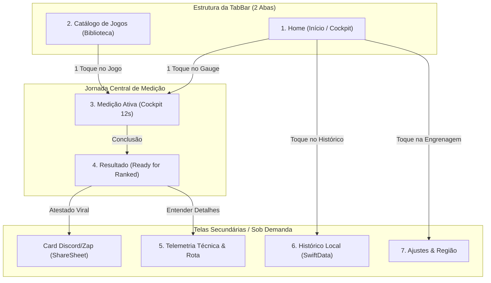

# LagCheck — Plano Integral de Redesenho e Blindagem (Decisão 64 e 65)

> **Documento de Aprovação de Produto e Engenharia**  
> **Autor:** Marco (Product Lead) em conjunto com Renan (Design), Rian (iOS), Iury (Rede), Breno (QA) e Camillo (Arquitetura)  
> **Aprovador Final:** Luiz (Dono do Produto)  
> **Status:** AGUARDANDO APROVAÇÃO  

---

## 1. Diagnóstico e Princípios Inegociáveis

### 1.1 O que desandou e está sendo erradicado
1. **Acúmulo de puxadinhos visuais:** O app acumulou heros concorrentes (Gauge circular brigando com Prateleiras Netflix, Billboard cinematográfica e Carrossel de Recentes). A Home perdeu o propósito de cockpit de 1 toque.
2. **"Cardlização" e cara de IA:** Telas inundadas de cartões soltos, títulos com subtítulos explicativos, badges redundantes e parágrafos didáticos sobre o que é jitter ou bufferbloat. **O gamer não lê.**
3. **Tela de Resultado poluída:** A tela de resultado virou uma fila vertical com 5 CTAs disputando o polegar do usuário (Testar Novamente, Compartilhar Discord, Entender Conexão, Ver Dicas IA, Exportar PDF).
4. **Instabilidade de transição de tela:** Variações bruscas de altura e safe-areas não ancoradas faziam o layout dar "pulos" visuais ao carregar dados.

### 1.2 Regras de Ouro desta Reformulação
* **Dark Competitive UI Pura:** Fundo quase preto `#0B0D10`, superfícies grafite `#15181E`, bordas finas de 1px `#262B35`, acento Coral Solar `#FF5A36` apenas no que é ação.
* **A "Regra do Discord":** Todo dado em tela deve ser compreensível em 1 segundo e traduzível para uma frase falada entre amigos na call.
* **Tempo Real Científico (10 a 12s):** Nem 5s mentirosos, nem espera infinita. Ciclo de medição auditável com haptics progressivos.
* **Zero Custo Recorrente:** Sem Firebase, sem servidores dedicados caros. Apenas o Cloudflare Worker gratuito existente para carga (`/v1/load`).

---

## 2. Inventário Completo de Telas do App

O LagCheck possui exatamente **7 telas** (2 abas principais, 1 tela transitória de medição, 1 tela de resultado, 2 fluxos de detalhe e 1 tela de ajustes):



---

## 3. Especificação e Wireframe Visual Tela a Tela

---

### TELA 1: Home (Início / Cockpit de 1 Toque)
* **Objetivo:** Permitir ao jogador ver a rota ativa e disparar o teste com um único toque.
* **Regra de layout:** Sem carrossel Netflix na Home. A Home é cockpit: topo com rota/Wi-Fi, centro dominante com o Gauge de 1 toque, rodapé com atalho rápido dos favoritos.

```text
+-------------------------------------------------------------+
|  [lagcheck]                     [Histórico]   [Ajustes]    |
|                                                             |
|  ● WI-FI 5GHZ · ROTA SÃO PAULO (AWS/GRU)                    |
|                                                             |
|                                                             |
|                     . - ~ ~ ~ - .                           |
|                 . '               ' .                       |
|               /                       \                     |
|              /      VALORANT BR        \                    |
|             |                           |                   |
|             |       TESTAR AGORA        |                   |
|             |        [ 1 TOQUE ]        |                   |
|              \                         /                    |
|               \                       /                     |
|                 . '               ' .                       |
|                     ' - ~ ~ ~ - '                           |
|                                                             |
|           Toque para medir conexão do jogo                  |
|                                                             |
|  FAVORITOS                                     [+ Editar]   |
|  +------------+ +------------+ +------------+ +-----------+ |
|  | VALORANT   | | FORTNITE   | | WARZONE    | | GERAL     | |
|  | [Selecion] | |            | |            | |           | |
|  +------------+ +------------+ +------------+ +-----------+ |
|                                                             |
|  [ Início ]                            [ Jogos ]            |
+-------------------------------------------------------------+
```

* **Elementos e Comportamento:**
  - **Header:** Wordmark minúscula `lagcheck` à esquerda. Ícones de Histórico e Configurações à direita.
  - **Pílula de Telemetria:** Mostra a interface física detectada (Wi-Fi 5GHz, 2.4GHz ou 5G) e o cluster de referência.
  - **Hero Gauge Pulsante:** Diâmetro de 240pt. Borda iluminada com pulso sutil em repouso. Se um favorito estiver selecionado, exibe o nome do jogo. Se nenhum estiver selecionado, exibe *"CONEXÃO GERAL"*.
  - **Trilho de Favoritos:** 4 botões horizontais compactos. Toque troca o alvo do teste instantaneamente.

---

### TELA 2: Catálogo de Jogos (Aba "Jogos")
* **Objetivo:** Encontrar qualquer jogo e disparar o teste imediato ou ver servidores suportados.
* **Regra de layout:** Busca instantânea no topo, filtros rápidos por plataforma (PC, Console, Mobile) e grade de cards esportivos limpos (sem capas piratas, apenas identidade neutra LagCheck).

```text
+-------------------------------------------------------------+
|  JOGOS                                                      |
|  [ 🔍 Buscar jogo ou servidor...                          ] |
|                                                             |
|  [ TODOS ]   [ PC ]   [ CONSOLE ]   [ IPHONE ]              |
|                                                             |
|  +-------------------------------------------------------+  |
|  | [NÓ] CONEXÃO GERAL COMPETITIVA                        |  |
|  | Rota direta para os maiores clusters de SP (AWS/Azure)|  |
|  | [ TESTAR ROTA GERAL ]                                 |  |
|  +-------------------------------------------------------+  |
|                                                             |
|  +---------------------------+ +--------------------------+ |
|  | VALORANT                  | | FORTNITE                 | |
|  | Riot Direct · São Paulo   | | AWS GameLift · sa-east-1 | |
|  | [ TESTAR ]                | | [ TESTAR ]               | |
|  +---------------------------+ +--------------------------+ |
|  +---------------------------+ +--------------------------+ |
|  | WARZONE                   | | CS2                      | |
|  | Battle.net · BR           | | Valve SDR · GRU          | |
|  | [ TESTAR ]                | | [ TESTAR ]               | |
|  +---------------------------+ +--------------------------+ |
|                                                             |
|  Não achou seu jogo? [ Sugerir jogo ao time ]               |
|                                                             |
|  [ Início ]                            [ Jogos ]            |
+-------------------------------------------------------------+
```

* **Elementos e Comportamento:**
  - **Busca:** Filtro em tempo real. Se o jogo não existir, o app exibe: *"Não achou [Nome]? Teste a Rota Geral ou [Peça aqui]"*.
  - **Card de Rota Geral:** Sempre fixado no topo para jogadores de títulos fora da lista.
  - **Cards de Jogos:** Tipografia monospaced esportiva, servidor da rota e botão de disparo direto.

---

### TELA 3: Medição Ativa (Cockpit Científico 10–12s)
* **Objetivo:** Mostrar ao gamer que o teste é real, matemático e auditável, sem deixá-lo no escuro.
* **Regra de layout:** Gauge animado com 3 fases claras e feedback háptico físico no iPhone.

```text
+-------------------------------------------------------------+
|  [ X Cancelar ]                                             |
|                                                             |
|                   MEDINDO ROTA VALORANT                     |
|                   São Paulo · Riot Direct                   |
|                                                             |
|                     . - ~ ~ ~ - .                           |
|                 . '      24ms     ' .                       |
|               /                       \                     |
|              /      FASE 2 / 3         \                    |
|             |   ESTRESSANDO ROTA...     |                   |
|             |                           |                   |
|             |     [||||||||||.....]     |                   |
|              \         68%             /                    |
|               \                       /                     |
|                 . '               ' .                       |
|                     ' - ~ ~ ~ - '                           |
|                                                             |
|             Simulando carga de partida (Bufferbloat)        |
|                                                             |
|  TELEMETRIA EM TEMPO REAL                                   |
|  +--------------------+ +--------------------+ +----------+ |
|  | PING ATUAL         | | JITTER             | | PERDA    | |
|  | 24 ms              | | 1.8 ms             | | 0.0%     | |
|  +--------------------+ +--------------------+ +----------+ |
|                                                             |
|  ● Nó 1: iPhone -> Roteador (Wi-Fi 5GHz OK)                 |
|  ● Nó 2: Rota Operadora -> São Paulo (Sob estresse)         |
+-------------------------------------------------------------+
```

* **Fases da Medição (Tempo Total: 10–12s):**
  - **Fase 1 (0–4s):** *Baseline de Repouso* (UDP contínuo, 30 amostras, cálculo do ping limpo).
  - **Fase 2 (4–9s):** *Estresse de Fila (Bufferbloat)* (Carga via Worker, haptics vibrando, verificação se o ping salta).
  - **Fase 3 (9–11s):** *Integridade de Pacotes* (RFC 4737 pacotes fora de ordem e tipo de NAT).
  - **Segundo 12:** Transição suave com crossfade imediato para o Resultado.

---

### TELA 4: Tela de Resultado (Protagonista: Ready for Ranked)
* **Objetivo:** Dar a resposta definitiva pro lobby do Discord: jogo ou não jogo?
* **Regra de layout:** Veredito gigante no topo. Card de 3 métricas limpo. Apenas 2 botões principais na cara da tela (Testar Novamente e Compartilhar no Discord). O restante é secundário.

```text
+-------------------------------------------------------------+
|  [ < Voltar ]                            VALORANT · SP      |
|                                                             |
|  =========================================================  |
|  ● PRONTO PARA RANKED                                       |
|  =========================================================  |
|  Sua rota está estável. Sem atraso de fila ou perda.        |
|                                                             |
|  +------------------+ +------------------+ +--------------+ |
|  | LATÊNCIA         | | JITTER           | | PERDA        | |
|  | 18 ms            | | 1.2 ms           | | 0.0%         | |
|  +------------------+ +------------------+ +--------------+ |
|                                                             |
|  ESTABILIDADE DA ROTA                                       |
|  [==============================================] 98%       |
|  Bufferbloat: Grau A (+4ms sob estresse)                    |
|                                                             |
|  [ TESTAR NOVAMENTE ]                                       |
|  (Botão Principal Coral Solar #FF5A36)                      |
|                                                             |
|  [ 💬 COMPARTILHAR ATESTADO PRO DISCORD / ZAP ]             |
|  (Gera card visual 1200x675 de 1 toque no ShareSheet)       |
|                                                             |
|  [ Entender conexão & dados técnicos > ]                    |
|  (Abre a tela de telemetria completa)                       |
+-------------------------------------------------------------+
```

* **Vereditos Possíveis (Decisão 50):**
  - `● PRONTO PARA RANKED` (Verde esmeralda / Rota lisa)
  - `▲ EU EVITARIA RANKED AGORA` (Laranja / Jitter alto ou Bufferbloat severo)
  - `▲ CONDIÇÕES INSTÁVEIS` (Vermelho / Perda de pacotes detectada)
  - `— INCONCLUSIVO` (Neutro / Conexão caiu ou dados insuficientes)

---

### TELA 5: Card Viral para Discord / WhatsApp (Geração Automática)
* **Objetivo:** O jogador cola o card na call ou no chat para provar que a rota tá lisa (ou culpar a internet legitimamente).
* **Formato:** PNG 1200x675 (16:9), estética esportiva, fundo escuro, contraste máximo.

```text
+-------------------------------------------------------------+
|  lagcheck                                   ● ATESTADO OFICIAL|
|                                                             |
|  VALORANT BRASIL                                            |
|  Servidor: Riot Direct (São Paulo)                          |
|                                                             |
|  =========================================================  |
|  ● PRONTO PARA RANKED                                       |
|  =========================================================  |
|                                                             |
|  +----------------+ +----------------+ +------------------+ |
|  | LATÊNCIA       | | JITTER         | | PERDA            | |
|  | 18 MS          | | 1.2 MS         | | 0.0%             | |
|  +----------------+ +----------------+ +------------------+ |
|                                                             |
|  Conexão: Wi-Fi 5GHz · Medido via iPhone · lagcheck.app     |
+-------------------------------------------------------------+
```

---

### TELA 6: Telemetria Técnica & Rota ("Entender Conexão")
* **Objetivo:** Atender ao usuário avançado ou curioso sem assustar o leigo na tela principal.
* **Acesso:** Sheet modal aberto pelo botão secundário da Tela de Resultado.

```text
+-------------------------------------------------------------+
|  [ Fechar ]                             DADOS DA CONEXÃO    |
|                                                             |
|  RESUMO DO DISPOSITIVO                                      |
|  Interface: Wi-Fi 802.11ac (5 GHz)                          |
|  Salto Gateway Local: 1.8 ms (Excelente)                    |
|  Topologia NAT: NAT Tipo 2 (Moderado / STUN RFC 5389)       |
|                                                             |
|  DETALHAMENTO DE ESTRESSE (BUFFERBLOAT)                     |
|  Latência em Repouso: 18 ms                                 |
|  Latência sob Carga: 22 ms (Variação: +4 ms)                |
|  Classificação da Fila: Grau A                              |
|                                                             |
|  AUDITORIA DE TRANSPORTE UDP                                |
|  Pacotes Enviados / Recebidos: 40 / 40                      |
|  Pacotes Fora de Ordem (RFC 4737): 0 (0.0%)                 |
|                                                             |
|  [ Exportar Relatório Técnico Completo em PDF ]             |
+-------------------------------------------------------------+
```

---

### TELA 7: Histórico Local (Persistência SwiftData)
* **Objetivo:** Comparar medições passadas e validar se o provedor melhorou ou piorou.
* **Acesso:** Ícone no topo direito da Home.

```text
+-------------------------------------------------------------+
|  [ < Voltar ]                                     HISTÓRICO |
|                                                             |
|  HOJE                                                       |
|  +--------------------------------------------------------+ |
|  | VALORANT · Riot Direct                     01:42       | |
|  | ● PRONTO PARA RANKED       18ms · 1.2ms jit · 0% loss  | |
|  +--------------------------------------------------------+ |
|  | FORTNITE · AWS sa-east-1                   00:15       | |
|  | ▲ EVITARIA RANKED         64ms · 14.8ms jit · 2% loss  | |
|  +--------------------------------------------------------+ |
|                                                             |
|  ONTEM                                                      |
|  +--------------------------------------------------------+ |
|  | CONEXÃO GERAL · SP                         22:30       | |
|  | ● PRONTO PARA RANKED       21ms · 2.0ms jit · 0% loss  | |
|  +--------------------------------------------------------+ |
|                                                             |
|  [ Limpar Histórico ]                                       |
+-------------------------------------------------------------+
```

---

### TELA 8: Ajustes & Região (Configurações)
* **Objetivo:** Seleção de servidor de referência, preferências de plataforma e privacidade.
* **Acesso:** Ícone de engrenagem no topo direito da Home.

```text
+-------------------------------------------------------------+
|  [ < Voltar ]                                       AJUSTES |
|                                                             |
|  ROTA DE MEDIÇÃO PADRÃO                                     |
|  Região: [ Automática (São Paulo - América do Sul)  > ]     |
|                                                             |
|  PLATAFORMA PREFERIDA                                       |
|  ( ) iPhone     (X) PC     ( ) Console                      |
|                                                             |
|  PRIVACIDADE & DADOS                                        |
|  ● Armazenamento 100% local no iPhone                       |
|  ● Zero rastreamento de IP ou dados pessoais                |
|                                                             |
|  Versão 1.0.0 (Build 36) · LagCheck                         |
+-------------------------------------------------------------+
```

---

## 4. Plano de Implementação em Fases (Engenharia)

| Fase | Frentes | Ações Concretas |
| :--- | :--- | :--- |
| **Fase 1: Navalha e Limpeza** | Rian / Renan | Remover componentes legados (carrossel Netflix da Home, banners de IA redundantes, empilhamento de botões na Resultado). |
| **Fase 2: Cockpit Home & Catálogo** | Rian / Renan | Reestruturar a Home em torno do Gauge de 240pt e favoritos rápidos; ajustar a aba Jogos com filtros limpos e Rota Geral. |
| **Fase 3: Medição 12s & Haptics** | Iury / Rian | Garantir as 3 fases de teste (0-4s repouso, 4-9s estresse bufferbloat, 9-11s RFC 4737/STUN, 12s veredito) com resposta tátil progressiva. |
| **Fase 4: Resultado & Share Discord** | Renan / Rian | Implementar a hierarquia visual limpa na Resultado e plugar o gerador PNG do Discord no ShareSheet. |
| **Fase 5: QA e Blindagem Visual** | Breno / Camillo | Executar testes no simulador iPhone 17 Pro, auditar safe-areas contra sobreposição de botões e validar suíte verde de 288 testes. |

---

## 5. Critérios de Aceite para Liberação

1. **Zero Textão:** Nenhuma tela contém parágrafos didáticos longos ou tom de assistente de IA.
2. **Zero Glitches Visuais:** Nenhum botão sobreposto, nenhuma tela pulando ao carregar resultado.
3. **Compartilhamento no Discord:** 1 toque gera a imagem nítida com veredito e ping, pronta para postar.
4. **Precisão Determinística:** O teste dura 10-12s, testa bufferbloat de verdade e não inventa nota.
5. **Compilação e Suíte:** 100% verde sem quebrar nenhuma dependência.
